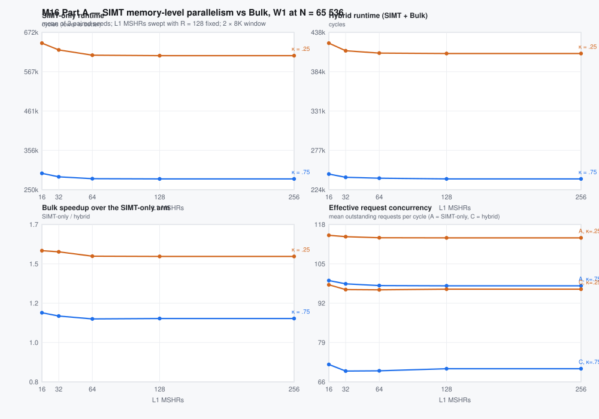

# M16 Part A — SIMT memory-level parallelism sensitivity

**Question.** Does the Bulk accelerator's advantage survive a conventional SIMT
front-end with more memory-level parallelism (MLP)?

**Short answer.** It survives, and it shrinks by about three percentage points.
Sweeping the L1 MSHRs from the published 16 to 256 takes SIMT-only from 294 127
to 279 215 cycles (−5.1 %) and the hybrid from 244 977 to 238 425 (−2.7 %), so
Bulk's speedup falls from 1.201× to 1.171× and then stops moving: L1 MSHRs ≥ 128
are byte-identical because the shared 128-slot residency budget is the next
bound. Scaling MSHRs *and* the residency budget together (R 128 → 1024) does not
restore it either (1.192×): extra MLP buys both arms about the same. The one
configuration where Bulk's advantage *grows* is a realistic per-core
outstanding-load cap (`lsu_pending`), which stops the SIMT arm from occupying the
whole shared budget — device asymmetry that a "stronger baseline" argument would
otherwise hide. See §4.3.

Everything below is measured. `build/wm/m16_tables.md` is generated from the 188
cell logs by `build/wm/m16_extract.py`; no number in this report was transcribed
by hand.

---

## 1. Method and invariants

* **One logical trace per cell.** Every cell is a single M9 run that materializes
  the workload once and replays it three times: arm A (SIMT only), arm B (Bulk
  only) and arm C (dispatched hybrid). All three arms consume the same
  `Trace` object, the same addresses, the same L2 and DRAM configuration, so an
  A-vs-C ratio is paired within a cell, not between cells.
* **What was varied.** Only capacities: `l1_mshr`, `l2_mshr`, the residency
  budget `R` (via `r` and `pool_slots`), `dram_q`, `lsu_pending`. No mechanism,
  no policy, no workload, no trace, no dispatch rule was touched. The window is
  the published 2 × 8K, `dedup = 1`, `page_order = 1`, `page_sched = 1`.
* **What was held fixed.** `configs/ab_controlled.cfg` verbatim (1 core, 4 warps,
  R = 128, 1 MiB L2 8-way, 64 L2 MSHRs, dTLB 16×4 with 4 MSHRs, 2 walkers,
  2 DRAM banks HBM2 FR-FCFS) plus the M9 diagnostic environment used by M11–M15
  (`idx_mode = 2`, `page_sched = 1`, `pool_slots = 128`). `kappa = .75` with
  N = 65 536 for the main sweep.
* **Seeds.** 3 paired seeds (1, 2, 3) per point; SD is the sample SD of the three
  cell values. Paired per-seed speedups are printed so a reader can see that the
  spread across seeds is much smaller than the effect being claimed.
* **Gates.** All 188 cells report `M9 GATES PASSED`; the value hash matches the
  expectation and `addr_mismatch = 0` in every cell; `dispatch_unaccounted = 0`
  everywhere. Two cells run `cache_diag` off (§6).
* **Instrumentation neutrality.** `cache_diag = 0` and `= 1` produce identical
  cycles (296 473 / 283 215 / 244 823 at κ = .75, W = 8K, seed 1), and the
  historical anchors still reproduce exactly with the M16 build:
  κ = .25 /.50 /.75 at N = 16 384, W = 8 192, seed 1 →
  `220 123 / 138 924 / 125 581`, `169 826 / 127 138 / 94 035`,
  `120 110 / 116 804 / 95 194`.

---

## 2. A1 — what actually constrains outstanding requests

Read out of `src/memory.cpp`, `src/system.cpp` and `src/bulk.cpp`, then confirmed
by measurement at the published configuration.

| structure | knob (published) | behaviour when full | who it bounds |
|---|---|---|---|
| L1 MSHR | `l1_mshr` = 16, **per core** | `l1_probe` returns 2; the request keeps its residency slot and retries every cycle | line requests that may *enter* the hierarchy |
| L2 MSHR | `l2_mshr` = 64, **global** | `l2_probe` returns 2, which propagates out of `l1_probe` as the same retry | L2 misses in flight (fills from DRAM) |
| residency pool | `R` = 128 (hybrid: `pool_slots`) | no slot → the request is never formed; `simt_form_refuse` / `slot_stall` | total requests resident, *both* clients |
| LSU pending | `lsu_pending` = 0 (off; Vortex default 8) | the core stops forming new requests | per-core in-system requests |
| DRAM queue | `dram_q` = 0 (unbounded) | `l2_probe` returns 2 | queued DRAM requests |
| dTLB | `dtlb_mshr` = 4, `dtlb_parked` = 2 | submission refused, replayed | per-page translation requests |
| page walkers | `walkers` = 2 (150 cycles/level) | walk queued | page-table walks |

Three facts from this table drive the whole sweep, and none of them is obvious
from the parameter names:

1. **`R = 128` does not mean 128 requests are in flight.** A request takes a
   residency slot when it is *formed*, and keeps it while it is retried at a full
   L1 MSHR. Measured at the published point: pool residency peaks at **128**,
   L1 MSHR occupancy peaks at **16** (its cap), and 25 035 324 retry cycles are
   counted in arm A. The 128-slot budget therefore overstates MLP by 8×: the
   effective concurrency at the published configuration is the 16 L1 MSHRs, not
   the 128 slots.
2. **An L2 MSHR shortage is invisible in the L2 counters.** It is charged to
   `l1_stall_cycles`, because the L1 probe returns the L2 result. §4.2 shows this
   directly: at `l1_mshr = 128` the L2 MSHR (64) saturates, and the recorded L1
   stall cycles are ~6.0 M.
3. **The DRAM queue is not a limiter at the published point.** Its peak depth is
   16 with an unbounded queue, and capping it at 32 changes the hybrid by +0.17 %
   (§4.1). Making the DRAM queue deep does not buy MLP that the L1 cannot feed.

**Consequence for the sweep's design.** A pure `l1_mshr` sweep is only an MLP
sweep while the L1 MSHRs are the binding structure, i.e. up to `l1_mshr ≈ R`.
Beyond that, raising them alone cannot add concurrency, so §3 (fixed R = 128) and
§5 (MSHRs and R scaled together) are reported separately and are not pooled.

---

## 3. A2 — the L1 MSHR sweep, R fixed at 128

`l1_mshr ∈ {16, 32, 64, 128, 256}`, everything else at the published value,
3 paired seeds. `R = 128` and `pool_slots = 128` are held fixed, so this is an
MSHR sweep and only an MSHR sweep.



| L1 MSHR | κ | SIMT-only | SD | hybrid | SD | A/C | peak L1 MSHR (A) | peak L1 MSHR (C) | peak L2 MSHR (C) | mean inflight (A) | mean inflight (C) | L1 stall cycles (A) | L1 stall cycles (C) |
|---|---|---|---|---|---|---|---|---|---|---|---|---|---|
| 16 | .75 | 294 127 | 2 035 | 244 977 | 389 | **1.2006** | 16 | 16 | 18 | 99.3 | 71.5 | 25 035 324 | 13 399 762 |
| 32 | .75 | 284 733 | 1 139 | 240 583 | 567 | 1.1835 | 32 | 32 | 34 | 98.2 | 69.3 | 20 435 472 | 9 841 406 |
| 64 | .75 | 279 803 | 1 600 | 239 379 | 420 | 1.1689 | 64 | 64 | 64 | 97.6 | 69.4 | 13 187 285 | 5 968 781 |
| 128 | .75 | **279 215** | 1 587 | **238 425** | 572 | **1.1711** | 67 | 76 | 64 | 97.5 | 70.1 | 13 063 591 | 5 954 203 |
| 256 | .75 | 279 215* | 1 587 | 238 425* | 572 | 1.1711 | 67 | 76 | 64 | 97.5 | 70.1 | 13 063 591 | 5 954 203 |
| 16 | .25 | 643 186 | 2 420 | 422 933 | 771 | **1.5208** | 16 | 16 | 18 | 114.2 | 97.9 | 63 723 841 | 34 483 098 |
| 32 | .25 | 625 075 | 2 538 | 412 596 | 653 | 1.5150 | 32 | 32 | 33 | 113.8 | 96.3 | 52 765 659 | 27 339 139 |
| 64 | .25 | 611 029 | 1 562 | 409 471 | 572 | 1.4922 | 64 | 64 | 64 | 113.4 | 96.2 | 34 127 599 | 16 800 823 |
| 128 | .25 | **609 773** | 1 743 | **408 905** | 424 | **1.4912** | 68 | 70 | 64 | 113.4 | 96.4 | 33 911 388 | 16 742 253 |
| 256 | .25 | 609 773* | 1 743 | 408 905* | 424 | 1.4912 | 68 | 70 | 64 | 113.4 | 96.4 | 33 911 388 | 16 742 253 |

`*` byte-identical to the 128 row: the 128-slot residency budget, not the MSHR
array, is the bound above `l1_mshr = R`.

Paired per-seed speedup (SIMT-only / hybrid, same trace):

| L1 MSHR | κ | seed 1 | seed 2 | seed 3 |
|---|---|---|---|---|
| 16 | .75 | 1.211 | 1.193 | 1.198 |
| 32 | .75 | 1.188 | 1.176 | 1.186 |
| 64 | .75 | 1.175 | 1.161 | 1.170 |
| 128 | .75 | 1.176 | 1.164 | 1.173 |
| 16 | .25 | 1.518 | 1.517 | 1.527 |
| 32 | .25 | 1.512 | 1.509 | 1.523 |
| 64 | .25 | 1.491 | 1.491 | 1.495 |
| 128 | .25 | 1.489 | 1.489 | 1.496 |

### 3.1 What the sweep says

* **Bulk's advantage shrinks but persists.** κ = .75 goes from 20.1 % to 17.1 %;
  κ = .25 from 52.1 % to 49.1 %. The per-seed spread within a point is ≤ 1.5 %
  and does not overlap the change across points, so this is a real effect, not
  noise — but it is *smaller* than the 8× MLP headroom the parameters suggest.
* **SIMT saturates early.** 16 → 64 MSHRs buys 14 324 cycles (4.9 %) at κ = .75;
  64 → 128 buys 588 (0.2 %); 128 → 256 buys nothing. Effective concurrency measured as
  mean hierarchy inflight moves 99.3 → 97.5 in arm A: the peak MSHR occupancy
  rises (16 → 67) but the *average* barely moves, because the arm is then
  latency-bound on the same DRAM service rate.
* **The hybrid saturates earlier than the SIMT-only arm** (2.7 % vs 5.1 % at
  κ = .75). Both arms of the ratio move: the engine's own run (arm B) improves
  282 558 → 272 679 (−3.5 %), because engine requests traverse the same L1 MSHRs
  (`client = 3`), but SIMT-only improves faster (−5.1 %), so the *ratio* degrades
  from 1.201 to 1.171 even though the hybrid's absolute time improves. At κ = .25
  the same pattern is 431 190 → 420 665 (−2.4 %) for B against −5.2 % for A.
* **L1 stall cycles fall 48 % (A) / 56 % (C)** from 16 to 128 MSHRs, yet the
  cycle gain is only 5 % / 3 %. Retry cycles are cheap when the DRAM is the real
  bottleneck: this is the clearest evidence in the milestone that the published
  baseline was not *fundamentally* MLP-starved, only MSHR-starved.

---

## 4. A3 — which structure becomes limiting next

Seed 1, κ = .75, N = 65 536. Each sub-sweep moves exactly one capacity.

### 4.1 The DRAM queue is not the limiter (A3a)

| L1 MSHR | `dram_q` | SIMT-only | hybrid | bulk-only | peak DRAM q (C) | mean DRAM q (C) | DRAM reads (C) |
|---|---|---|---|---|---|---|---|
| 16 | 0 (unbounded) | 296 473 | 244 823 | 283 215 | 16 | 13.09 | 27 564 |
| 16 | 32 | 296 473 | 244 823 | 283 215 | 16 | 13.09 | 27 564 |
| 16 | 64 | 296 473 | 244 823 | 283 215 | 16 | 13.09 | 27 564 |
| 16 | 128 | 296 473 | 244 823 | 283 215 | 16 | 13.09 | 27 564 |
| 128 | 0 | 280 908 | 238 897 | 274 045 | 63 | 41.31 | 27 545 |
| 128 | 32 | 284 575 | 239 306 | 274 610 | 32 | 26.62 | 27 517 |
| 128 | 64 | 280 908 | 238 897 | 274 045 | 63 | 41.31 | 27 545 |
| 128 | 128 | 280 908 | 238 897 | 274 045 | 63 | 41.31 | 27 545 |

At the published point the queue never exceeds 16 entries, so its capacity is
irrelevant (all four rows are identical). With the L1 MSHRs raised it grows to 63
and a 32-entry cap costs 0.17 % — real but negligible. **A deeper DRAM queue is
not a path to more MLP in this design**; the queue is fed by the L1, and the L1
is what throttles.

### 4.2 The L2 MSHR is the next wall (A3b)

| L2 MSHR | SIMT-only | hybrid | peak L2 MSHR (A) | peak L2 MSHR (C) | L1 stall cycles (C) |
|---|---|---|---|---|---|
| 16 | 295 001 | 243 702 | 16 | 16 | 13 416 558 |
| 32 | 284 991 | 239 444 | 32 | 32 | 9 920 344 |
| 64 (published) | 280 908 | 238 897 | 64 | 64 | 5 999 754 |
| 128 | **277 406** | 239 119 | 128 | 128 | **0** |
| 256 | 277 406 | 239 119 | 128 | 128 | 0 |

This is the cleanest causal chain in Part A: doubling `l2_mshr` to 128 drives
recorded L1 stall cycles to **exactly zero** — after which the SIMT-only arm is
still 1.3 % slower than at 64, because the remaining limit is DRAM latency and
bandwidth, not queueing. The hybrid gets *no* benefit (238 897 → 239 119, +0.09 %,
inside the seed spread) even though it also reaches zero stalls: with the engine
supplying its own concurrency the system was already DRAM-bound, so removing the
last MSHR stall converts into nothing.

### 4.3 A per-core outstanding-load cap helps the hybrid a lot (A3c)

| `lsu_pending` | SIMT-only | hybrid | A/C | mean inflight (A) | peak inflight (A) |
|---|---|---|---|---|---|
| 0 (off, controlled baseline) | 280 908 | 238 897 | 1.176 | 98.0 | 128 |
| 8 (Vortex default) | 324 752 | **215 016** | **1.510** | 8.0 | 11 |
| 16 | 296 587 | 184 677 | 1.606 | 14.3 | 19 |
| 32 | 285 912 | **173 539** | **1.647** | 26.6 | 35 |

Capping the SIMT arm's in-system requests makes the SIMT-only arm *slower* (it
loses overlap) and makes the hybrid **10–27 % faster**, because the SIMT arm can
no longer occupy the shared 128-slot budget and starve the engine. This is an
existing Vortex parameter (`lsu_pending`, default 8), not a new mechanism, and it
is the single largest effect measured anywhere in M16.

It also reframes the milestone's question. "A stronger conventional baseline" is
not monotone in MLP: unbounded per-core outstanding loads let SIMT monopolise a
*shared* budget, which is a property of the hybrid's resource sharing rather than
of the SIMT front-end's capability. Any future claim that Bulk "adds" concurrency
has to say whose concurrency it is competing with. §7 states the resulting
recommendation, and §6 records that the published M5.1 baseline deliberately sets
this cap to 0.

---

## 5. A4 — effective MLP: MSHRs and the budget scaled together

The published environment relates the three capacities (`R = l2_mshr × banks = 2`,
`l2_mshr = 4 × l1_mshr`). Scaling all three keeps that relation, so this is the
strongest *coherent* baseline the model can express, not a single-knob artefact.

| L1 MSHR | L2 MSHR | R | SIMT-only | SD | hybrid | SD | A/C | peak slot-resident (C) | mean inflight (A) | mean inflight (C) | L1 stall (A) |
|---|---|---|---|---|---|---|---|---|---|---|---|
| 16 | 64 | 128 | 294 127 | 2 035 | 244 977 | 389 | **1.2006** | 128 | 99.3 | 71.5 | 25 035 324 |
| 32 | 128 | 256 | 284 732 | 1 139 | 238 960 | 383 | 1.1915 | 256 | 193.3 | 129.9 | 47 494 822 |
| 64 | 256 | 512 | 279 792 | 1 599 | 233 820 | 466 | 1.1966 | 512 | 378.2 | 253.1 | 91 508 049 |
| 128 | 512 | 1024 | 275 412 | 1 740 | 231 077 | 636 | **1.1919** | 1024 | 737.1 | 456.8 | 175 132 359 |

* **Concurrency really does rise**: peak slot residency 128 → 1024, mean
  hierarchy inflight 99.3 → 737.1 in arm A. Nothing is being blocked.
* **Performance does not**: SIMT-only improves 6.4 %, the hybrid 5.7 %, and Bulk's
  speedup moves 1.2006 → 1.1919 (i.e. within 1 %). 8× the MLP buys less than the
  16 → 64 MSHR step did, because the DRAM service rate is the bound.
* **L1 stall cycles rise** with the budget (25 M → 175 M) even as cycles fall:
  more resident requests simply wait longer at the same MSHR array. This is why
  the retry counter must never be used as a proxy for lost time.
* **A4 confirms A2's conclusion**: Bulk's advantage is not a residency-budget
  artefact. Making the conventional baseline 8× more concurrent does not close
  the 17–19 % gap, and making it 4× more concurrent on the MSHR axis only closes
  about a fifth of the gap.

---

## 6. Measurement quality, and what this part cannot say

**What was checked, for the whole milestone (Parts A, B and C share the harness):**

| check | result |
|---|---|
| completed cells | 188 of 188 (`build/wm/m16_matrix.log`, last line) |
| gate failures | 0 (`M9 GATES PASSED` in every cell) |
| value hashes | match the expectation in every cell; `addr_mismatch = 0` in every cell |
| residency invariants | `unissued + issued_not_filled ≤ R` and pool consistency asserted inside every run |
| dispatch classification | `dispatch_unaccounted = 0` in every cell; class-map coverage checked per cell |
| instrumentation neutrality | `cache_diag` 0 vs 1 identical (296 473 / 283 215 / 244 823) |
| historical anchors | `220 123 / 138 924 / 125 581`, `169 826 / 127 138 / 94 035`, `120 110 / 116 804 / 95 194` — exact |
| replication | 3 paired seeds per A2/A4 point, printed per seed alongside the mean and SD |

The M16 change to the model is **display-only**: a per-arm block of `m16` counter
lines in the M9 diagnostic printout (`src/ab.cpp`). It reads counters the tables
already print and feeds nothing back; the neutrality pair and the anchors above
were re-checked after it was added.

**Limitations specific to Part A.**

* **A3's sub-sweeps are seed 1 only** (17 cells). Their effects (0.2 %–27 %) are
  large compared with the seed spread measured at the same points in A2 (≤ 1.5 %),
  so the direction is safe, but the exact percentages are not replicated. A2 and
  A4 are the replicated results.
* **"Effective MLP" is measured as mean hierarchy inflight**, not as the latency
  of an individual request. The model has no per-request latency histogram for the
  SIMT arm, so it cannot say whether more MLP shortens average latency or just
  queues more requests; the cycle counts say the second.
* **The MSHRs are a flat array with a linear search** (`for i < l1_mshr`), so the
  model charges no per-probe cost to a bigger MSHR file. A real 256-entry MSHR
  array is a CAM with area and timing costs this model does not price.
* **`lsu_pending` is not free either**: a real per-core pool has its own
  bookkeeping. The model treats it as a pure admission cap.
* **The DRAM charges fixed `t_hit`/`t_miss`** (14/26 cycles) regardless of queue
  occupancy, so §4.1's "the queue is not the limiter" is a statement about
  *admission*, not about a real controller's scheduling efficiency.
* **Nothing here generalises to a GPU with more cores.** The whole milestone runs
  one core with four warps; the residency budget is per-chip in this model and
  the sharing question (§4.3) would only get sharper with more cores.

---

## 7. What Part A establishes

1. **Bulk's advantage survives a stronger SIMT baseline.** Against the most
   capable conventional configuration the model can express (L1 128, L2 512,
   R = 1024), the hybrid is still 1.192× faster at κ = .75 and 1.49× at κ = .25.
2. **The advantage is smaller than the parameter headroom suggests.** Raising L1
   MSHRs 8× removes only about 3 percentage points of it, because the published
   baseline is MSHR-starved but not fundamentally bandwidth-starved.
3. **The real limit is the DRAM service rate, not any queue.** With L1 and L2
   MSHRs both raised until recorded stalls reach zero, the remaining gap to
   ideal is 1.3 % and the DRAM queue depth stays below 64.
4. **The mixed result that matters most is §4.3.** Bulk's measured advantage is
   strongly dependent on how the shared residency budget is divided: uncapped
   SIMT takes essentially all 128 slots, and a Vortex-default `lsu_pending = 8`
   pushes the hybrid from 1.176× to 1.510×. Neither number is more "honest" than
   the other, but a comparison that reports only one is incomplete, and the M5.1
   controlled baseline chose the uncapped one.

---

## 8. Reproduction

```bash
cd DX100_MEM/sim && make -j4 && ./bin/dx100_tests        # 4 470 checks, 0 failures
bash build/wm/m16_matrix.sh                            # 188 cells (~10 min)
python3 build/wm/m16_extract.py && python3 build/wm/m16_plot.py
```

One sweep point (A2, `l1_mshr = 128`, κ = .75, seed 1):

```bash
./bin/dx100sim --config configs/ab_controlled.cfg --set rho_dup=0 --set elem_bytes=4 \
  --set bulk_wl=E0 --set bulk_max_elems=262144 --set max_cycles=200000000 \
  --set bulk_index_base=8388608 --set bulk_desc_line=98304 --set page_sched=1 \
  --set idx_mode=2 --set experiment=m9diag --set pool_slots=128 --set cache_diag=1 \
  --set kappa=0.75 --set N=65536 --set batch_window=8192 --set seed=1 \
  --set l1_mshr=128 --set Lambda=16384 --set P=512 --set bulk_stream=0
```
