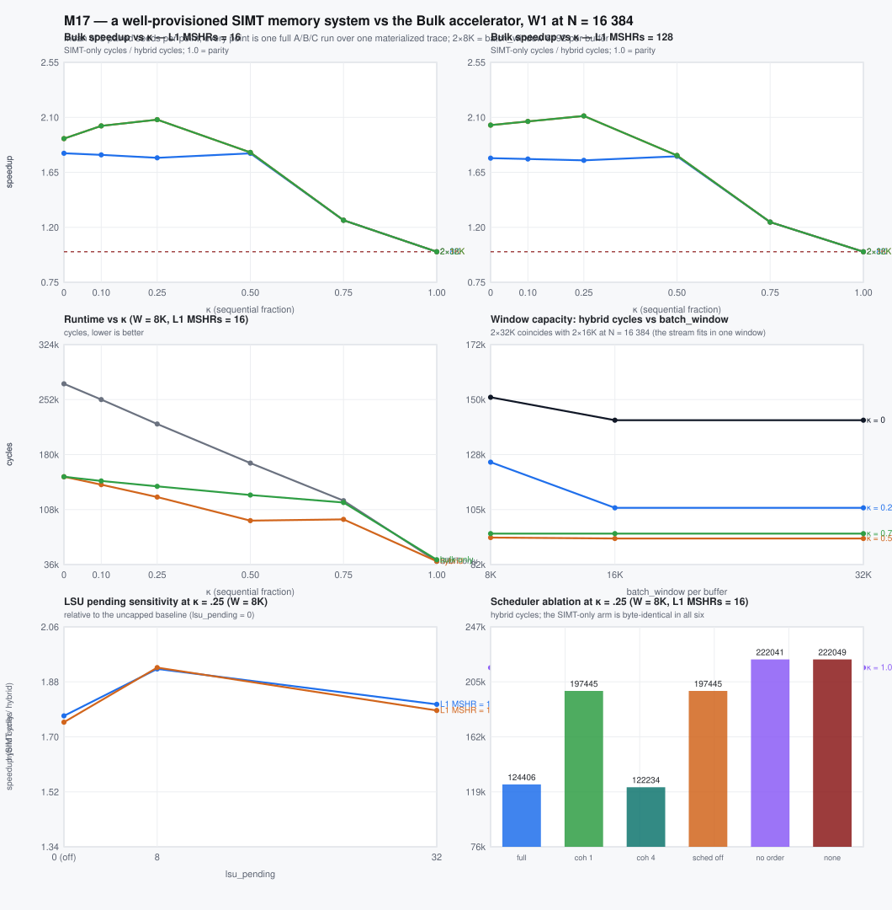

# M17 Phase 3 — κ sensitivity

**Question.** How does the relative performance of SIMT and Bulk change across
κ, and why?

**Answer.** Bulk's speedup is not a function of κ. It is a function of the
**DRAM row-locality gap** between the two arms, and κ happens to close that gap
monotonically. Measured at W = 8K, 16 MSHRs: SIMT's row-hit rate is **1.4 %** at
κ = 0 and **93.6 %** at κ = 1.00, while the engine stays at **83.7–87.5 %**
throughout, because it manufactures locality by issuing page-ascending whatever
the stream looks like. Bulk speedup falls from **1.81×** to **1.00×** across the
same range, and at κ = 1.00 the two row-hit rates are identical (93.6 %) and the
speedup is exactly 1.000.

The window-capacity effect is *not* monotone in κ either: 2×16K is 6–15 %
faster than 2×8K at κ ≤ 0.25, essentially equal at κ = 0.50 (−0.4 %), and
identical at κ ≥ 0.75, because at high κ the hybrid becomes engine-bound and the
engine's own run stops improving with capacity.

---

## 1. Method

| item | value |
|---|---|
| κ values | 0 (extra, for the anchor lineage), 0.10, 0.25, 0.50, 0.75, 1.00 |
| N | 16 384 (so κ is not confounded with workload size) |
| configurations | SIMT-only, bulk-only, hybrid — all three per cell |
| windows | 2×8K (8 192 per buffer), 2×16K, 2×32K |
| L1 MSHR | 16 and 128 (both, at every κ and window) |
| seeds | 5 paired (identical trace for all three arms in a cell) |
| cells | 180 (6 κ × 3 W × 2 MSHR × 5 seeds) |
| gates | 180/180 `M9 GATES PASSED`, `dispatch_unaccounted = 0`, value hash matches |

κ = 0 and κ = 1.00 are boundary cases worth stating up front: at κ = 0 the
existing dispatch classifier routes **every** element to the engine (arm C is
byte-identical to arm B), and at κ = 1.00 it routes **none** (arm C is
byte-identical to arm A). Those two rows therefore compare "all SIMT" against
"all engine" and vice versa; they are not hybrids. Every κ in between is a real
dispatch split.

## 2. What κ actually changes (measured)

| κ | N | distinct target lines | duplicate accesses | accesses / line | distinct pages | lines / page | working set |
|---|---|---|---|---|---|---|---|
| 0 | 16 384 | 16 384 | 0 | 1.000 | 512 | 32.00 | 1 024.0 KiB |
| 0.10 | 16 384 | 14 853 | 1 531 | 1.103 | 512 | 29.01 | 928.3 KiB |
| 0.25 | 16 384 | 12 636 | 3 748 | 1.297 | 512 | 24.68 | 789.8 KiB |
| 0.50 | 16 384 | 9 319 | 7 065 | 1.758 | 512 | 18.20 | 582.4 KiB |
| 0.75 | 16 384 | 6 376 | 10 008 | 2.570 | 512 | 12.45 | 398.5 KiB |
| 1.00 | 16 384 | 4 096 | 12 288 | 4.000 | 128 | 32.00 | 256.0 KiB |

These are counters exported by the run (`trace_lines`, `trace_pages`) plus N from
the run header; duplicates are N − distinct lines, i.e. the number of accesses
that revisit a line already touched.

κ is a **sequential fraction**, not a scatter factor: the regular path walks the
line array linearly, and κ is the probability that an instruction takes that
path. So raising κ does two things at once — it shrinks the realized footprint
(16 384 → 4 096 lines, a 4× reduction, because the linear walk keeps re-touching
the same prefix) and it raises the duplicate count 0 → 12 288. The page count
falls to 128 at κ = 1.00 only because 4 096 lines at λ = 32 span 128 pages.

**Consequence for interpretation.** Any κ trend can be explained equally well by
"more sequential instructions" or by "smaller footprint". §4 separates them with
the measured row-hit and TLB counters; the ratio does not follow from κ itself.

## 3. Speedup vs κ

L1 MSHR = 16 (mean of five paired seeds, N = 16 384):

| κ | 2×8K SIMT-only | 2×8K bulk-only | 2×8K hybrid | **A/C** | 2×16K hybrid | **A/C** |
|---|---|---|---|---|---|---|
| 0 | 272 638 | 150 952 | 150 952 | **1.8061** | 141 559 | **1.9260** |
| 0.10 | 252 071 | 145 512 | 140 629 | 1.7925 | 124 193 | 2.0297 |
| 0.25 | 220 019 | 138 380 | 124 406 | 1.7686 | 105 716 | 2.0812 |
| 0.50 | 168 884 | 127 041 | 93 542 | 1.8054 | 93 172 | 1.8126 |
| 0.75 | 119 664 | 117 189 | 95 140 | 1.2578 | 95 140 | 1.2578 |
| 1.00 | 40 281 | 42 301 | 40 281 | 1.0000 | 40 281 | 1.0000 |

L1 MSHR = 128:

| κ | 2×8K SIMT-only | 2×8K hybrid | **A/C** | 2×16K hybrid | **A/C** |
|---|---|---|---|---|---|
| 0 | 262 783 | 148 822 | **1.7658** | 129 036 | **2.0365** |
| 0.10 | 242 869 | 138 101 | 1.7586 | 117 533 | 2.0664 |
| 0.25 | 211 495 | 120 988 | 1.7481 | 100 162 | 2.1115 |
| 0.50 | 162 767 | 91 386 | 1.7811 | 91 045 | 1.7878 |
| 0.75 | 117 046 | 94 217 | 1.2423 | 94 217 | 1.2423 |
| 1.00 | 40 281 | 40 281 | 1.0000 | 40 281 | 1.0000 |

Per-seed values and SDs for all 180 cells are in `m17_tables.md` (P3); the SD
within a configuration is 0.7–1.5 % of the mean, and 0 at κ = 1.00 where the run
is deterministic (one arm).

## 4. Why the curve has that shape

At W = 8K, 16 MSHRs:

| κ | row hit % (A) | row hit % (C) | TLB misses (A) | TLB misses (C) | DRAM reads (A) | DRAM reads (C) | bank util % (A) | bank util % (C) |
|---|---|---|---|---|---|---|---|---|
| 0 | 1.4 | 87.5 | 15 867 | 1 626 | 16 417 | 17 445 | 77.8 | 89.6 |
| 0.10 | 1.8 | 86.1 | 14 554 | 1 656 | 14 914 | 15 867 | 76.3 | 88.4 |
| 0.25 | 3.9 | 83.7 | 12 206 | 1 719 | 12 662 | 13 469 | 73.5 | 86.4 |
| 0.50 | 12.8 | 88.1 | 8 145 | 1 189 | 9 279 | 9 752 | 67.2 | 80.4 |
| 0.75 | 37.1 | 83.8 | 4 086 | 1 208 | 6 400 | 6 654 | 57.6 | 55.8 |
| 1.00 | 93.6 | 93.6 | 256 | 256 | 4 105 | 4 105 | 75.3 | 75.3 |

Three measured regularities:

1. **SIMT's locality tracks κ; the engine's does not.** A's row-hit rate rises
   1.4 → 93.6 % while C stays in a narrow 83.7–88.1 % band. At κ = 1.00 they
   coincide and the speedup is exactly 1.000. The dTLB shows the same shape
   (15 867 → 256 misses against a flat ~1 200–1 700), because a 16-entry dTLB
   thrashes on a scattered 512-page stream and is comfortable on a linear one.
2. **The engine always reads ~5–7 % more DRAM lines than SIMT** (index array +
   descriptor), and that tax is present at every κ including the ones where it
   wins. It is not what decides the comparison.
3. **Bank utilisation is not the explanation.** At κ = 0.75 the SIMT arm has
   *higher* bank utilisation (57.6 % vs 55.8 %) and is still 20 % slower,
   because utilisation counts row-miss cycles as busy work: A converts 63 % of
   its reads into row conflicts, C converts 16 %.

**What actually decides it** is transactions per unit of useful data movement:
at κ = 0.25, C issues 1.063× the DRAM reads of A but completes in 0.565× the
cycles, because 84 % of its reads hit an open row. The hybrid is not buying
concurrency; it is buying row locality it can then spend.

### 4.1 Where the hybrid's advantage comes from at high κ

The engine-alone column is the tell:

| κ | bulk-only vs SIMT-only | hybrid vs SIMT-only | overlap gain (bulk-only ÷ hybrid) |
|---|---|---|---|
| 0 | 1.806 | 1.806 | 1.000 (no SIMT work to overlap) |
| 0.10 | 1.732 | 1.793 | 1.035 |
| 0.25 | 1.590 | 1.769 | 1.112 |
| 0.50 | 1.329 | 1.805 | 1.358 |
| 0.75 | 1.021 | 1.258 | 1.232 |

At κ ≤ 0.25 the advantage is the engine's own speed (row locality), and overlap
adds little. At κ ≥ 0.50 the engine is barely faster than the SIMT arm on its own
(1.02× at κ = .75) and nearly all of the hybrid's advantage comes from **running
both clients concurrently**. Those are two different reasons to want the
accelerator, and the combined report keeps them apart.

## 5. Window capacity vs κ

| κ | 2×8K | 2×16K | 2×16K vs 2×8K | 2×32K |
|---|---|---|---|---|
| 0 | 150 952 | 141 559 | −6.2 % | 141 559 (identical) |
| 0.10 | 140 629 | 124 193 | −11.7 % | 124 193 (identical) |
| 0.25 | 124 406 | 105 716 | −15.0 % | 105 716 (identical) |
| 0.50 | 93 542 | 93 172 | −0.4 % | 93 172 (identical) |
| 0.75 | 95 140 | 95 140 | 0.0 % | 95 140 (identical) |
| 1.00 | 40 281 | 40 281 | 0.0 % | 40 281 (identical) |

**2×32K is degenerate at N = 16 384** and the matrix demonstrates it rather than
assuming it: all five seeds at both MSHR settings produce cycles identical to
2×16K, because one window of 16 384 entries already holds the whole stream.

The capacity axis is only meaningful when a window cannot span the whole stream,
so `P6` repeats the comparison at N = 65 536, κ = 0.25:

| W | L1 MSHR | SIMT-only | bulk-only | hybrid | A/C | lines issued | dedup merges |
|---|---|---|---|---|---|---|---|
| 16 384 | 16 | 643 186 | 390 210 | 442 070 | 1.4549 | 49 187 | 32 |
| 16 384 | 128 | 609 773 | 373 065 | 390 275 | 1.5624 | 49 187 | 32 |
| 32 768 | 16 | 643 186 | 305 390 | 301 502 | **2.1333** | 32 747 | 16 472 |
| 32 768 | 128 | 609 773 | 272 214 | 266 670 | **2.2866** | 32 763 | 16 456 |

At N = 65 536 the 2×32K window folds 16 472 duplicate accesses (33 % fewer line
requests) and gains 47 %. That gain is **deduplication**, unlocked because the
window now spans the reuse distance — not capacity as such. It is also the one
place in M17 where a mechanism (dedup) does measurable work at κ = 0.25, where at
N = 16 384 it merges nothing.

So the answer to "does 2×16K consistently beat 2×8K" is: **at κ ≤ 0.25 yes, by
6–15 %; at κ ≥ 0.50 no**, and above N ≈ W the axis is about dedup reach, not
window size.

## 6. What this part establishes

1. **Bulk's advantage is bounded by the locality gap, not by κ.** It is largest
   where SIMT's access stream is scattered (κ ≤ 0.25: 1.75–2.08×) and disappears
   exactly when SIMT's stream becomes as row-friendly as the engine's
   (κ = 1.00: 1.000×, identical row-hit and TLB-miss counts).
2. **κ is a poor explanatory variable on its own.** It correlates with footprint
   (16 384 → 4 096 lines), duplicate count (0 → 12 288), row-hit rate
   (1.4 → 93.6 %) and TLB pressure (15 867 → 256 misses) simultaneously. The
   report therefore reports all four measured statistics and uses the row-hit
   and TLB counters — not κ — as the mechanism.
3. **The 128-MSHR baseline does not change the shape.** Every κ point moves by
   ≤ 1 pp of speedup toward the SIMT arm; the ordering of κ points is unchanged.
4. **Two regimes.** Low κ: the engine is faster on its own and the hybrid tracks
   it. High κ: the engine is barely faster alone and the hybrid's gain is
   overlap. A single scalar "speedup" hides which one is being measured.

## 7. Limitations

* **One geometry.** Λ = 16 384, P = 512, λ = 32, N = 16 384. M8's break-even map
  shows page density (P) moves SIMT by up to 3.9× at fixed κ, so κ is not the
  only first-order control and this sweep does not vary P.
* **κ and ρ are not crossed.** κ > 0 with ρ > 0 is representable but untested
  here (M8 flagged the same gap); the DUP workload in M15/M16 is the closest
  proxy.
* **κ = 1.00 is a boundary, not a workload.** Dispatch sends nothing to the
  engine, so the 1.000× row measures the classifier, not the accelerator. The
  engine on its own would be 42 301 vs 40 281 cycles (5 % slower).
* **No histogram of reuse.** The generator exports distinct lines and duplicate
  count, not a reuse-distance distribution; "reuse distribution" is therefore
  reported as mean accesses per line plus the dedup-merge count.
* **`dram_row_hits` counts only reads** and the model charges fixed 14/26-cycle
  timings regardless of queue occupancy, so row-hit *rate* is a locality proxy,
  not a latency measurement.
