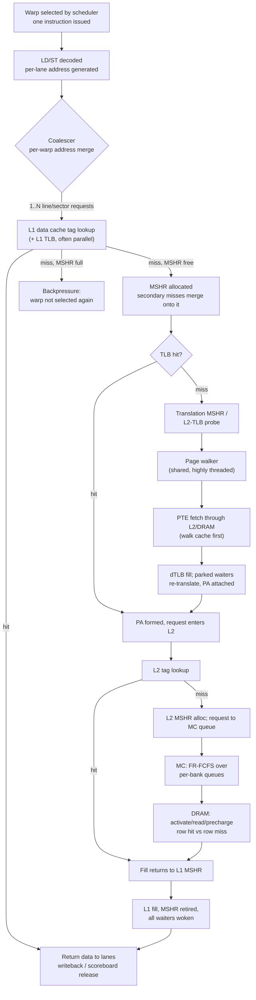

# M27 — Read-only GPU architecture reference and integration audit

**Scope.** This report inspects the existing `DX100_MEM` simulator against published GPU
architecture, and reports what the model actually implements. It is **read-only**: no source file was
modified, no configuration was changed, no build, test, benchmark or simulation was run, no timing
parameter was touched. The only artifact produced is this document. All source references are to the
tree as it stood at the end of M26-B1 (see §2.4 for how to confirm that).

**How to read the evidence levels.** Every substantive statement is tagged:

- **[F] Fact** — read directly from the source or from a primary document, with a citation.
- **[I] Interpretation** — my reading of those facts against the literature; could be wrong.
- **[U] Unknown** — insufficient evidence; named as a question, not resolved.

---

## 1. Executive summary

The simulator is a **trace-driven memory-system model with two front-ends**, not a GPU
microarchitecture. It models, in reasonable detail, the parts of the memory pipeline that the Bulk
question is about — coalescing, a private L1 with MSHRs, a shared L2, a two-level TLB with walkers, a
FR-FCFS DRAM controller — and it does **not** model warp scheduling, instruction issue, execution
units, scoreboards or the memory network. That is a legitimate class of model (GPGPU-Sim's memory
system is the same class, with more detail), and it is well enough instrumented to answer
request-level questions. It is not a source of absolute performance numbers, and nothing in it has
ever been correlated against hardware.

**The four findings that matter most.**

1. **A confirmed liveness defect in the translation interface** (M26-B1), now located at source level:
   `tlb_probe` answers a dTLB *hit* with a promise (`ready = cycle + 1`,
   `sim/src/memory.cpp:236`), but the request keeps **no private copy** of the translation and
   re-reads the shared array one cycle later. If a fill replaces the entry in that cycle, the request
   re-runs only the *lookup* (`sim/src/memory.cpp:1090-1119`) and can never recover. Every miss path
   has a guarantee (a parked waiter on an MSHR, `memory.cpp:241-283`); the hit path has none. This
   is a defect, not an abstraction, and it affects SIMT and Bulk alike.

2. **The L1-bypass question is largely moot in the audited baseline — and the premise was wrong.**
   The engine does set `bypass_l1 = true` at seven sites, and the comment cites "design §4.4", but
   `MemorySystem::path_bypasses_l1` (`sim/src/sim.hpp:961`) ignores that flag whenever
   `mem_path != "native"`. The pinned M24-D/M25/M26 baseline sets **`mem_path = l1`**
   (`build/wm/m24d/m24d_bulk.cfg`), so in every published comparison **Bulk traffic goes through the
   same L1 as SIMT**, shares its MSHRs, merges on line match, and evicts by the same LRU. The bypass is
   a real code path, reachable only in `native` mode, and is a *configuration* choice with an existing
   switch — not a structural property of the Bulk engine.

3. **The DRAM timing model is the weakest part of the baseline, and the M3 mapping experiment was an
   artefact.** `l2_latency = 4`, `t_hit = 14`, `t_miss = 26`, `link = 0`, and `dram_q = 0` (an
   **unbounded** memory-controller queue). One command per cycle, latency charged to the bank, no bus
   occupancy, no `tRRD`/`tFAW`/refresh. Separately, the production decode reduces the row index modulo
   `rows`, so with `2 banks × 4096 rows × 1 KiB = 8 MiB` of capacity and an 8.0 MiB working set, M3's
   20-bit permutation aliases pages onto shared rows (§8.5). The M24-A effect is real *in the model*
   and is a property of capacity wraparound, not of hardware.

4. **Request conservation is established at three levels and holds in every completed run** — slot
   pool (`SlotPool::consistent`, `sim.hpp:778`), hierarchy (`issued == completed + inflight`,
   `system.cpp:407`), and window records (`win_alloc == win_recs.size()`, `bulk.cpp:3657`). The 6
   failing configurations in the M26 suite fail **one** invariant, the retirement of an already
   stranded request, not the bookkeeping. That is the strongest argument for repairing rather than
   replacing the simulator.

**Verdict.** The foundation is **credible for relative, memory-system-level research after a small
number of targeted repairs**, and **not credible** for absolute performance numbers or for any claim
whose mechanism depends on realistic DRAM timing. The defects found are localized (one liveness gap,
one set of timing constants, one mapping artefact), not architectural. Rewriting is not indicated;
re-validation is.

---

## 2. Research references and their relevance

Primary sources, with the specific claim each supports. Where a source is a research paper that
*models* a commercial GPU rather than vendor documentation, it is marked as such, because a model's
parameters are not a vendor specification.

| # | Source | Org / authors | Date | URL | Architectural claim it supports here |
|---|---|---|---|---|---|
| R1 | *NVIDIA A100 Tensor Core GPU Architecture* (whitepaper) | NVIDIA | 2020-08 | https://www.nvidia.com/content/dam/en-zz/Solutions/Data-Center/nvidia-ampere-architecture-whitepaper.pdf | Unified L1/shared-memory block (192 KB/SM on A100); 40 MB L2 as a **shared** resource outside the SMs; L2 partitioned for bandwidth. Establishes the two-level on-chip hierarchy the simulator models. |
| R2 | *NVIDIA H100 Tensor Core GPU Architecture* | NVIDIA | 2023-05 | https://resources.nvidia.com/en-us-hopper-architecture/nvidia-h100-tensor-c | Same structure, larger (256 KB/SM L1+shared). Shows the model is not generation-specific in structure. |
| R3 | *CUDA C++ Programming Guide — Coalesced Access to Global Memory* / *Best Practices Guide* | NVIDIA | current | https://docs.nvidia.com/cuda/cuda-c-best-practices-guide/index.html | Warp accesses coalesce into the number of **32-byte sector transactions** needed to serve the warp; the transaction count, not the line count, is the unit of memory traffic from compute capability 6.0 on. |
| R4 | *NVIDIA Ampere Tuning Guide* | NVIDIA | 2020-08 | https://docs.nvidia.com/cuda/archive/11.0/pdf/Ampere_Tuning_Guide.pdf | The unified L1/Texture cache "acts as a **coalescing buffer** for memory accesses, gathering up the data requested by the threads of a warp". Coalescing happens *at* the L1, not before it. |
| R5 | Power, Hill, Wood, *Supporting x86-64 address translation for 100s of GPU lanes* | HPCA 2014, U. Wisconsin | 2014-02 | https://arch.cs.ucdavis.edu/gpu/memory/2014/02/15/gpummu.html | **Post-coalescer TLBs**: the coalescer and scratchpad filter the translation rate by 6.8×; TLB misses arrive in **bursts** (~60 concurrent); post-coalescer TLB miss rates average **29 %**; a workable design is per-CU TLBs + a shared highly-threaded walker + a shared page-walk cache, at <2 % overhead with 4 KiB pages. |
| R6 | Shin, Cox, Oskin, Loh, Solihin, Bhattacharjee, Basu, *Scheduling Page Table Walks for Irregular GPU Applications* | ISCA 2018 | 2018-06 | https://www.csa.iisc.ac.in/~arkapravab/papers/GPU_page_walk_scheduler_ISCA_18.pdf | Walk *ordering* determines translation overhead; instructions that touch many distinct pages need disproportionately more translation work; a wavefront cannot proceed until **all** its lanes' translations complete. |
| R7 | *DUCATI: Extending TLB reach of GPU-accelerated systems* | ACM TACO 16(1) | 2019-03 | https://dl.acm.org/doi/10.1145/3309710 | Last-level TLB misses cost multiple page-table accesses even with a walk cache; on-die TLB capacity is the binding constraint for GPU working sets. |
| R8 | Bakhoda, Yuan, Fung, Wong, Aamodt, *Analyzing CUDA Workloads Using a Detailed GPU Simulator* (GPGPU-Sim) | ISPASS 2009, UBC | 2009-03 | https://people.ece.ubc.ca/aamodt/publications/papers/gpgpusim.ispass09.pdf | The reference simulator architecture: per-SM L1 with MSHRs, shared L2, DRAM controller, warp scheduling. Defines the abstraction level DX100_MEM belongs to. |
| R9 | Khairy, Shen, Aamodt, Rogers, *Accel-Sim: An Extensible Simulation Framework for Validated GPU Modeling* | ISCA 2020 | 2020-05 | https://people.ece.ubc.ca/aamodt/publications/papers/accelsim.isca2020.pdf | A simulator's memory model must be **correlated** against hardware; the same paper's GPGPU-Sim 4.0 memory model is the current detailed reference. |
| R10 | Khairy, Jain, Aamodt, Rogers, *A Detailed Model for Contemporary GPU Memory Systems* | ISPASS 2019 | 2019-03 | https://mkhairy.github.io/Docs/ispass2019.pdf | Memory-system counters in the prior model were wrong by up to **66×**; FR-FCFS vs FCFS changes conclusions in the detailed model but not in the old one. Directly relevant: a coarse DRAM model can invert a scheduling conclusion. |
| R11 | Rixner, Dally, Kapasi, Mattson, Owens, *Memory Access Scheduling* | ISCA 2000, Stanford | 2000-05 | http://cva.stanford.edu/publications/2000/mas.pdf | The bank/row/column structure and the ~10× bandwidth difference between row-hit and row-miss ordering; FR-FCFS (ready-first, then oldest) as the baseline scheduler. |
| R12 | Ausavarungnirun et al., *MASK: Redesigning the GPU Memory Hierarchy to Support Multi-Application Concurrency* | ASPLOS 2017 | 2017 | https://rausavar.github.io/pubs/ | GPU memory controllers must balance row-buffer locality against **fairness**; a locality-maximising scheduler starves low-locality clients. Relevant to any "separate DRAM sorter" claim. |
| R13 | Park et al., *A Case for Speculative Address Translation with Rapid Validation for GPUs* | 2024 | 2024-11 | https://www.cs.cmu.edu/~18742/papers/Park2024.pdf | A published **modelled** A100-class configuration used as a sanity reference for scale: L1 TLB 32 entries / 32 MSHRs, L2 TLB 1024 entries 8-way / 128 MSHRs, 16 walkers, 128 walk-cache entries, L1 39 cycles, L2 187 cycles, DRAM page 4 KB. *(Research model, not a vendor spec.)* |
| R14 | *Staged Memory Scheduling* (SMS) | ISCA 2012 | 2012-05 | https://rausavar.github.io/pubs/sms_isca12.pdf | FR-FCFS "prioritizes requests that result in row-buffer hits, and otherwise prioritizes older requests" — the exact policy the simulator implements, and the reason it exists. |

**What the literature does *not* establish.** [I] There is no public evidence that any commercial GPU
exposes a client that (a) receives pre-translated physical addresses in a private buffer, (b) reorders
its own release order by physical DRAM row, and (c) is exempt from the residency budget during
translation. Those are properties of the *proposed* Bulk design, not of NVIDIA or AMD pipelines.
Nothing in this audit should be read as "GPUs do this"; the honest statement is "GPUs do the
conventional parts, and Bulk adds a client the reference designs do not have".

---

## 3. The conventional GPU memory pipeline (reference model)

### 3.1 Lifecycle of a SIMT memory request



Interactions and overlap: coalescing and the L1 lookup proceed while older requests occupy MSHRs;
translation and data fetch overlap for *different* requests but not within one (a request cannot enter
L2 until its PA exists); MSHR capacity is what converts memory latency into memory-level parallelism,
and its exhaustion is the main source of backpressure at the L1; the L2 MSHR file is the second such
bound; the MC queue is the third. Backpressure is expressed as "the request is not re-issued", never
as "the request is dropped" [R5, R8, R9].

### 3.2 The four distinctions the audit depends on

- **Virtual vs physical page.** A VPN is what the lane computes; a PPN is what the cache and DRAM see.
  The mapping is owned by the page table and cached in the TLB; a translation is *state*, and a
  request that has been translated must not need the TLB again [R5, R7].
- **Page organisation vs DRAM row/bank organisation.** A page is a 4 KiB (or 64 KiB / 2 MiB) aligned
  region; a DRAM row is a device-internal unit of 1–8 KiB that a bank buffers. There is **no fixed
  relationship** between them: the address map decides how many rows a page spans and whether two
  pages can touch one row [R11, R14].
- **Cache-line coalescing vs request deduplication.** Coalescing merges *lanes* of one instruction
  into line/sector requests [R3, R4]. Deduplication merges *requests* for a line already outstanding,
  which is what an MSHR file does by tag match [R8, R9]. The first is a front-end function; the second
  is a property of every level that has MSHRs.
- **Translation concurrency vs memory-level parallelism.** Translation concurrency is bounded by TLB
  MSHRs and walkers (tens); MLP is bounded by cache MSHRs and the residency budget (hundreds). A
  design can have ample MLP and still serialise on translation — the specific failure mode R6
  describes.

### 3.3 Accepted → translated → issued → returned → retired

"Accepted" is the front-end's claim on its residency budget. "Translated" is the PA becoming known.
"Issued to memory" is entering the L2/DRAM path. "Returned" is the fill arriving. "Retired" is the
front-end releasing the slot and waking the dependent. In a conventional pipeline translation happens
*inside* an accepted request and never outlives it; retirement is the only event that releases a slot,
and it is driven by the fill, which is owned by an MSHR. The invariant that makes this safe is:
**every accepted request is owned by exactly one structure that will eventually signal it** (MSHR,
queue entry, or the request's own captured result). The audit's central question (§7) is whether
DX100_MEM preserves that invariant on every path.

---

## 4. DX100_MEM: what the model actually contains

### 4.1 Structure

```
sim/src/main.cpp        CLI: --config, --set, --all
sim/src/util.cpp        Config parsing, defaults (util.cpp:1-300)
sim/src/workload.cpp    trace construction (build_trace)
sim/src/system.cpp      SIMT front-end: coalescing, R slots, issue, retirement
sim/src/bulk.cpp        Bulk engine: descriptor, index stream, window, sorter, release
sim/src/memory.cpp      MemorySystem: TLB, walkers, L1, L2, DRAM, lifetime accounting
sim/src/hbm.cpp         optional M24-B HBM controller (dram_kind = hbm; not the baseline)
sim/src/ab.cpp          experiment drivers and report emitters
sim/src/sim.hpp         all data structures (Config, Req, MemorySystem, BulkEngine)
sim/tests/tests.cpp     ~4,940 checks incl. conservation and the two M26 liveness cells
```

[F] There is **no instruction pipeline**: `SimtCore` holds a list of trace instruction indices
(`system.cpp:24-38`), each expanded into the distinct 64 B lines of that instruction
(`system.cpp:184-196`). There is no warp scheduler, no register file, no execution unit, no scoreboard,
no instruction cache. "Issue" means "the memory request is presented to the hierarchy".

[F] There is **one global residency budget** `R` (`sim.hpp:48`, default 128; the pinned baseline 128),
implemented by `SlotPool` (`sim.hpp:734-779`) and, in the pure paths, by per-core `free_slots` vectors
(`system.cpp:98-101`, `bulk.cpp:395-412`). A slot is taken when a line request is *formed* and released
when its fill is *attributed*.

[F] There is **one `inflight_` vector** for every client (`memory.cpp:1050`, `1084`, `1196`), and
completions come back as a packed `(core << 32) | slot` (`memory.cpp:1179`, consumed at
`system.cpp:161-176` and `bulk.cpp:660-678`).

### 4.2 The parameterisation actually used for the M24/M25/M26 comparisons

From `build/wm/m24d/m24d_bulk.cfg` (pinned; the SIMT arm is the same file with an 8-line
architecture block substituted — the header states this and `tools/m24d_config_audit.py` enforces it):

| group | value | reference |
|---|---|---|
| topology | 1 core, 4 warps, 4 lanes, `elem_bytes = 4`, `R = 128`, `lsu_pending = 0` (unlimited) | cfg §1 |
| path | **`mem_path = l1`** | cfg §1 |
| L1 | 16 KiB, 4-way, 2-cycle latency, **128 MSHRs** (one per R slot) | cfg §2, `sim.hpp:56` |
| L2 | 1 MiB, 8-way, **4-cycle latency**, 64 MSHRs | cfg §2 |
| dTLB | 16 entries, 4-way, 8 MSHRs, 2 parked waiters per MSHR | cfg §3 |
| L2 TLB | 512 entries, 4-way, 8 MSHRs, 4-cycle latency, 8 requests served per in-flight entry | cfg §3, `sim.hpp:60-63` |
| walkers | 8, walk cache 16 entries, 2 levels, 150 cycles/level | cfg §3 |
| DRAM | **2 banks, 4096 rows, 1 KiB rows**, `t_hit 14`, `t_miss 26`, `link 0`, **`dram_q = 0` (unbounded)**, FR-FCFS, XOR bank hash | cfg §4 |
| page | 4 KiB (`page_line_bits() = 6`), Sv32, 2-level | cfg §5, `sim.hpp:172` |
| guard | `max_cycles = 500 000 000` | cfg §11 |

Default `Config` differs where the pinned file overrides: `cores 4`, `l1_mshr 16`, `l2_latency 12`,
`dtlb_mshr 4`, `banks 16`, `rows 1024`, `dram_q 32`, `walkers 2` (`sim.hpp:49-70`). [F] The
**pinned values, not the defaults, are what every M24/M25/M26 number was produced with**, and the
whole audit below is about the pinned file.

### 4.3 What is shared and what is not

| resource | SIMT | Bulk | shared? |
|---|---|---|---|
| residency budget R | `free_slots` / `SlotPool` | `SlotPool` via `alloc_slot` (`bulk.cpp:397`) | **yes**, one pool (`bulk.cpp:3296-3300`) |
| dTLB (per core) | core *c* | core 0 only (`bulk.cpp:2364`) | physically separate arrays; with `cores = 1` the same one |
| L2 TLB, walkers, walk cache | yes | yes | **yes** (`memory.cpp:308-464`) |
| L1 | core *c* | core 0 when `mem_path = l1` | **yes** in the pinned baseline |
| L2 | yes | yes | **yes** (`memory.cpp:507`) |
| DRAM controller | yes | yes | **yes**, one `dram_wait_` / one `HbmController` |
| completion path | `done` → slot free | `attribute_done` → `on_line` → fanout | **same `done` list**, different consumers |
| translation *result* transport | none (PA written into the request) | `xlate_done_` ring + engine PA buffer | **no** (engine-only side channel) |

[F] The engine's translation probes deliberately hold **no residency slot**:
`r.slot = 0xffffffffu; // a translation holds no residency slot` (`bulk.cpp:2364`). A SIMT request
holds a slot for its whole life including translation. This is the single largest structural
asymmetry in the model (§9.3).

---

## 5. Request lifecycles, traced in source

### 5.1 A. Conventional SIMT path

| step | code | what happens |
|---|---|---|
| 1. instruction selection | `system.cpp:169-196` | per core, round-robin or blocked over instruction ids; up to one *issue attempt per warp per cycle* (`cap = warps_per_core`, `system.cpp:167`) |
| 2. address generation | `system.cpp:184-196` | the trace already holds per-lane line numbers; the "coalescer" collects the **distinct 64 B lines** of one instruction into `cur_lines` |
| 3. slot claim | `system.cpp:198-215` | while `!free_slots.empty()`, form a `Req` (va_line, vpn, core, slot, seq) and push to `held` |
| 4. admission | `system.cpp:169-180` → `memory.cpp:990` | `submit()`; false means "try again next cycle" (request kept, counted as `simt_issue_stalls`) |
| 5. dTLB | `memory.cpp:215-283` | hit → `ready = cycle+1`, **no MSHR, no state**; miss → MSHR alloc/join, `ready = NONE`, waiter parked |
| 6. walk | `memory.cpp:308-464` | L2 TLB → miss → `ptw_tick` issues walks at 150 cycles/level; retire pushes `pending_fill_` |
| 7. fill | `memory.cpp:1075-1085` | `tlb_fill` installs (LRU victim), MSHR cleared |
| 8. stage-1 lookup | `memory.cpp:1088-1119` | **re-reads the dTLB array**; on miss, `keep.push_back(r); continue;` — *no re-probe* |
| 9. cache | `memory.cpp:1145-1160` | `l1_probe` (or `l2_probe` when bypassing); rc 2 = backpressure (`replays++`) |
| 10. MSHR merge | `memory.cpp:624-660` (L1), `531-546` (L2) | same line in this core's file → join, adopt that MSHR's ready cycle |
| 11. L2 / DRAM | `memory.cpp:663-728`, `729-860` | L2 MSHR → `dram_wait_` → FR-FCFS one command/cycle |
| 12. return | `memory.cpp:855-872` | `m.ready = cycle + lat + l2_latency`; L1 MSHRs for the line adopt it + `l1_latency` |
| 13. wake | `memory.cpp:670-690` | every `stage == 2` request with matching `(core, pa_line)` and `ready == NONE` gets the cycle |
| 14. retire | `memory.cpp:1163-1183` | latency split (`gen→tlb_at→now`), counter, `done.push_back(core<<32|slot)` |
| 15. slot free | `system.cpp:161-176` | `free_slots.push_back(slot)`, `completed++` |

### 5.2 B. Bulk path (the pinned configuration: g6b streaming organiser, `bulk_org = 8`)

| step | code | what happens |
|---|---|---|
| 1. dispatch | `bulk.cpp:413-430`, `496-560` | descriptor validated (magic, count, stride, base bounds), engine made active |
| 2. index acquisition | `bulk.cpp:836-975`, `1013-1067` | `idx_issue` submits `ReqKind::Index` line requests (`client = 1`, `bypass_l1 = true`, **holds a slot**) through the normal hierarchy |
| 3. index consumption | `bulk.cpp:876-928` | `idx_take` returns whichever element is ready, in order; value → `addr = data_base + v*data_bytes` |
| 4. page cohort / admission | `bulk.cpp:1093-1173`, `2614-2640` | elements grouped into **64 B line runs** keyed by VA line; `page_dir` (512) bounds distinct pages per window; `batch_window` (16384) bounds entries |
| 5. seal | `bulk.cpp:1173-1310`, `1493-1560` | the window closes, runs sorted by physical line (`page_order`), cohort table built, groups opened |
| 6. translation admission | `bulk.cpp:2354-2386` | per run, a **`xlate_only` probe** (`client = 2`, `bypass_l1 = true`, `slot = 0xffffffff`, no slot) is submitted until `ready + pending >= g6b_pa_capacity` (4096) |
| 7. translation retirement | `memory.cpp:1113-1140` | stage-1 hit → `pa_line` computed → pushed into `xlate_done_` (ring, 8192) → request retired, **no cache probe** |
| 8. ready pool insertion | `bulk.cpp:2321-2333` | `take_xlate` → `b.fpa[li] = pa`, `ready_push(b, fpos[li])` |
| 9. physical-order release | `bulk.cpp:2388-2440`, `1890-1970` | `pick_candidate`/`pick_group` choose among *ready* runs by (bank,row) locality; `win_emit_fused` gates on `free_count() > tgt_reserve()`, takes a slot, submits a `pretranslated` request with `gen = translation submit`, `tlb_at = translation done` |
| 10. memory | same `MemorySystem` | probe, MSHR, L2, DRAM — identical code to §5.1 steps 9-13 |
| 11. completion | `bulk.cpp:2734-2750` | `on_line` (or reuse buffer) → `push_fan` → fanout retires elements |
| 12. window retirement | `bulk.cpp:2926-3010`, `642-660` | when every element of the window has fanned out: window record closed, `desc_completed++` when elements == count |

### 5.3 Where the paths share, and where they diverge

**Shared** [F]: `MemorySystem::submit`, the whole `inflight_`/tick machinery, dTLB, L2 TLB, walkers,
L1 (under `mem_path = l1`), L2, MSHR files, DRAM controller, the latency counters, and the slot pool.

**Divergent** [F]:

1. **Coalescing.** SIMT deduplicates the lanes of one instruction into lines (`system.cpp:190-196`);
   Bulk deduplicates *across the whole window* at seal time into runs by VA line
   (`bulk.cpp:1173-1310`). Different unit of work, far larger window.
2. **Translation.** SIMT translates inside the request that needs the data (one phase). Bulk
   translates in a *separate request* that holds no slot and never touches a cache
   (`xlate_only`, `memory.cpp:1113-1140`), then releases the data request later against a buffered PA.
3. **Ordering.** SIMT issues in instruction/coalescer order. Bulk reorders its release order by
   physical row, using `dram_row_open` (`memory.cpp:891-901`) as a prediction.
4. **Completion routing.** SIMT gets `(core, slot)` on the global `done` list. Bulk gets the same, but
   routes through `attribute` → `on_line` → `push_fan`, keyed by `b.fslot[li]` and
   `p.win_batch/p.win_line`.
5. **Backpressure.** SIMT stops forming new requests when `free_slots` is empty. Bulk stops forming
   when `free_count() <= tgt_reserve()`, where `tgt_reserve()` reserves up to `R/4` slots for the index
   stream (`bulk.cpp:1314`) — a partition of R, not an addition to it.

---

## 6. Cache integration audit (question A)

### 6.1 What established designs do

[F, R1-R4] Every NVIDIA SM has a private unified L1/shared-memory block, and *all* global loads and
stores from that SM go through it; the L1 doubles as the coalescing buffer. Stores are write-through
to L2, loads are cached. The L2 is shared by all SMs. Nothing in the vendor documentation describes a
client that reaches L2 while skipping the L1 of the SM that issued it.

[F, R5] Research agrees: the *post-coalescer* TLB and the L1 sit in series, and the design space is
about how much of the L1/L2 path a translation request may bypass, not whether data requests may skip
the L1.

### 6.2 What DX100_MEM does — and the premise correction

| question | answer | evidence |
|---|---|---|
| Do SIMT requests access the L1? | yes, unless `mem_path = l2` | `memory.cpp:1147` → `l1_probe` (`memory.cpp:608`) |
| Do Bulk requests access the L1? | **yes in the pinned baseline**, because the engine's `bypass_l1` flag is only honoured in `native` mode | `sim.hpp:961`: `path_mode_==2 \|\| (path_mode_==0 && req_wants_bypass)`; `path_mode_` set from `mem_path` at `memory.cpp:80-83`; baseline sets `mem_path = l1` |
| Is the engine's flag ever honoured? | yes, under `mem_path = native` (the historical default) | seven sites set it: `bulk.cpp:758, 1025, 1347, 1912, 2118, 2368, 2565` |
| Can Bulk access the L2? | always | `memory.cpp:507` |
| Can Bulk merge with an existing cache/MSHR request? | yes, by tag, in the L1 file of core 0 and in the shared L2 file | `memory.cpp:624-636` (L1 tag match → `mshr_joins++`), `memory.cpp:531-546` (L2) |
| Is the bypass required by the design? | **no** — it is stated as a design choice ("the engine has no private L1 (design §4.4)"), and the A/B harness deliberately forces both arms onto one path | `bulk.cpp:758`; `ab.cpp:236-237` rejects `mem_path = native` for controlled runs; `bulk.cpp:4401-4406` asserts the engine produces L1 traffic whenever `mem_path = l1` |
| Does the choice change traffic/reuse/ordering/fairness? | yes on all four, and the model *measures* the interference (`l1_evict_cross`, `l2_evict_cross`) | `memory.cpp:684-694` |

**Verdict: [F] the "Bulk bypasses L1" premise is true of the code path but false of the audited
baseline.** In every M24-D / M25 / M26 cell the engine and the SIMT arm share one L1, one L2, one
MSHR file per level. The bypass exists only as the `native`-mode ablation.

### 6.3 The one thing that is *not* sound about the L1 path when `cores > 1`

[F] The engine hard-codes `r.core = 0` for every request it submits (`bulk.cpp:1917, 2364`), and
`l1_probe` indexes `ebase = core * l1_lines` (`memory.cpp:609`). So under `mem_path = l1` the engine
uses **core 0's private L1**. With `cores = 1` that is the only L1 and the abstraction is harmless.
With `cores > 1` it means the engine's traffic is routed through one SM's private cache — an artefact,
not a design. [I] This does not affect any published cell (all use `cores = 1`), but it must be fixed
or documented before any multi-core Bulk experiment. Classify: **Deviation** (latent, not currently
exercised).

### 6.4 Is there a technically sound way to integrate Bulk with the cache hierarchy?

[I] Yes, and three of the four options already exist in the tree:

1. **Share the L1 of the SM that issues** (`mem_path = l1`, the baseline). Sound for `cores = 1`;
   requires a per-engine home SM otherwise.
2. **Bypass L1 and enter the L2** (`mem_path = l2`). This is what the design intends and what real
   GPUs do *not* do, but it is a defensible architectural proposal (a DMA-like client entering at the
   socket arbiters) as long as it is labelled as part of the proposal, not as a GPU property.
3. **A private engine-side buffer that is *not* a cache** (the reuse buffer, `bulk.cpp:2775-2900`).
   Already present and independent of the L1/L2 decision.
4. **A separate L1 slice for the engine** — not present; would need a new array and a fair-share rule.

Recommendation for any future comparison: keep (1) as the primary arm — it is the only one in which
"Bulk gets the same cache hierarchy as SIMT" is literally true — and report (2) as an ablation whose
cost is attributed to the proposal.

---

## 7. Translation and request-retirement audit (questions B and C)

### 7.1 The M26-B1 defect, confirmed at source

```cpp
// memory.cpp:215-283
for (u32 w = 0; w < cfg_.dtlb_ways; ++w)
  if (e.valid && e.vpn == vpn) { st.hits++; e.lru = ++lru_clock_;
    ready = cycle + 1;            // <-- a promise, with no state behind it
    return true; }
...
m.parked++;                       // miss path: a waiter that the fill will wake
```

```cpp
// memory.cpp:1088-1119   (stage 1, every cycle, for the request's whole life)
u64 ppn = 0; bool found = false;
for (u32 w = 0; w < cfg_.dtlb_ways; ++w)
  if (e.valid && e.vpn == r.vpn) { ppn = e.ppn; found = true; break; }
if (!found) { keep.push_back(r); continue; }   // <-- re-lookup, never re-probe
```

[F] **Where the result should be retained:** in the request. `Req` has `pa_line`, `tlb_at`, `stage`
(`sim.hpp:690-700`) but nothing that records a *hit* result; the PPN is re-derived from the array on
every cycle until it is found. The probe's only output is `ready`.

[F] **The interface loses the information.** `tlb_probe(core, vpn, cycle, ready)` returns a bool and a
cycle; on a hit it does not return the PPN, does not touch an MSHR, and does not mark the entry. The
invariant that every other path preserves — *an accepted request is owned by something that will
signal it* (§3.3) — is broken on exactly this path.

[F] **How established designs avoid it:** the translation is captured *with* the request (or with the
MSHR entry that represents it), and the TLB is only consulted again after a miss [I, from R5/R7's
structure: post-coalescer TLB lookup, then MSHR allocation carrying the PA]. A cache that can evict
between two reads cannot be the store of a value a request depends on.

[F] **Who is affected:** both arms. M26-B1 recorded four stranded requests: two client-2 PTE probes
(Bulk) and two client-0 SIMT requests. So this is not a Bulk bug; it is a defect of the shared
translation interface that Bulk's phase-1 probes make more frequent (§9.3).

**Not a fix, just the shape the evidence supports** [I]: either capture the PPN at probe time into the
request (a pointer/`ppn` field set by `tlb_probe`), or park a hit's request on the entry the same way
a miss parks on an MSHR, so the fill-or-hit is guaranteed. Both are local; neither changes a latency.

### 7.2 Other translation-state and retirement risks found

| # | observation | code | classification |
|---|---|---|---|
| 1 | `xlate_done_` entries are matched to a window by **position** (`x.seq & 0xffffffff`), not by a window id; a discarded window's in-flight translations would be accepted by the *next* window's empty `ftr` array | `memory.cpp:1123`, `bulk.cpp:2321-2333` | **latent hazard**. Not reachable today: `abort_desc()` is only called from descriptor-validation failures before any work starts (`bulk.cpp:487, 502, 507, 513`), and `finish_desc` only runs when every translation has landed. Reachability should be re-checked if an abort path is ever added. |
| 2 | a dTLB fill clears **every** MSHR of that core with the same VPN, unconditionally | `memory.cpp:1076-1082` | Faithful (one MSHR per VPN per core, cleared on fill); `parked` waiters are woken through the stage-1 lookup, which is the defect in §7.1. |
| 3 | a refused probe decrements `reads`/`misses` so backpressure is not counted as a translation event | `memory.cpp:240-244, 279-283` | Faithful accounting; the caller keeps the request and retries `submit`. |
| 4 | `xlate_only` retires **without** a `done` message | `memory.cpp:1128-1140` | Intentional (the engine learns through `xlate_done_`); means `issued != completed` at the front-end is not a bug for those requests — the engine checks `g6b_tr_reqs == g6b_tr_done` instead. |
| 5 | stage-2 wake matches `(core, pa_line)` rather than request identity | `memory.cpp:670-690, 694-700` | Sound **because** at most one MSHR exists per line per level (alloc only after a failed tag search, `memory.cpp:533-560`), so waking by line cannot wake the wrong request. Would break if merging were ever removed. |
| 6 | `xlate_done_` ring capacity 8192 is a silent**overflow** guard: past it, `xlate_overflow++` and the translation is dropped while the request still retires | `memory.cpp:1123-1132` | **Potential defect** (latent): it is counted (`life_xl_rej` in M26), and B1 measured 0 in both cells. The engine cannot drain faster than `eng_issue` per cycle, so a window with > 8192 in-flight translations could hit it; `g6b_pa_capacity = 4096` prevents that in the pinned config. |

### 7.3 Can request conservation be established from the current implementation?

[F] Yes, at four independent levels, and they are all checked mechanically:

1. **Slot pool:** `free + held[0] + held[1] == owner.size()` after every take/give
   (`sim.hpp:778`), with `give` returning false on a double release or phantom completion.
2. **Hierarchy:** `issued == completed + inflight` (`system.cpp:407`), plus
   `tlb reads == hits + misses`, `l1/l2 reads == hits + misses` (`system.cpp:409-415`).
3. **Front-end:** `generated == issued + unissued` (`system.cpp:405`).
4. **Bulk:** `desc_submitted == desc_completed`, `win_alloc == win_recs.size()`,
   `sum(win.n) == win_entries`, `elems_done + addr_faults == bulk_elems`
   (`bulk.cpp:3648-3665`).

[I] What these do **not** prove is *liveness*: conservation was satisfied in the M26 failing cells only
because the run was aborted, after which the six violations are reported. Before B1, a stranded request
would have looked like a slow run until the 500 M-cycle guard fired. The lesson for the audit: the
simulator checks arithmetic conservation well and liveness not at all — which is exactly the gap that
produced three milestones of confusing performance experiments.

---

## 8. Memory-level parallelism and DRAM audit (questions D and E)

### 8.1 Concurrency limits, as implemented

| limit | value (pinned) | binding? | evidence |
|---|---|---|---|
| residency budget `R` | 128 | **yes**, the primary bound | `sim.hpp:48`, `bulk.cpp:3296` |
| L1 MSHRs | 128 (= R) | **no** — could never be exhausted before R is | cfg §2; `memory.cpp:652-660` returns 2 (backpressure) if full |
| L2 MSHRs | 64 | **yes** — the bound on concurrent DRAM misses | cfg §2; alloc `memory.cpp:540-560`, freed at fill `memory.cpp:715` |
| dTLB MSHRs | 8, 2 parked each | **yes** for translation: ≤ 8 distinct VPNs pending, ≤ 2 waiters per VPN, ≤ 16 parked | cfg §3; `memory.cpp:241-283` |
| L2 TLB MSHRs | 8 (8 requests per entry) | **yes** | `sim.hpp:61-62` |
| walkers | 8 | yes for cold pages | cfg §3, `memory.cpp:380-420` |
| walk cache | 16 entries | yes (a miss costs a full 2-level walk = 300 cycles) | cfg §3 |
| Bulk ready pool | `g6b_pa_capacity = 4096` translations + in-flight | **rarely binding** (measured peak 335 and 4096 in two cells) | `bulk.cpp:2340-2350` |
| Bulk window | 16384 entries | yes, window size | cfg §7 |
| page directory | 512 distinct pages per window | yes for high-footprint cells | cfg §8 |
| DRAM queue | **unbounded** (`dram_q = 0`) | no — the L2 MSHR file already caps it at 64 | cfg §4; `memory.cpp:538-545` |

[I] Two of these deserve comment.

**The L1 MSHR file is set to exactly R (`l1_mshr = 128`).** A real SM has far fewer L1 MSHRs than its
outstanding-request budget (R13's modelled A100-class SM has 32 L1 TLB MSHRs and a much larger data
path), and MSHR exhaustion is a first-order backpressure mechanism in the literature [R5, R8, R9]. In
this model the L1 can hold every request the budget allows, so **L1 MSHR pressure never occurs** and the
only cache-level pressure is the 64-entry L2 file. That is a defensible simplification for a
row-locality study but it removes a real bottleneck that interacts with coalescing (poor coalescing
consumes MSHRs faster).

**Effective DRAM concurrency is small: 2 banks.** Because `banks = 2`, at most two rows are open at
once, and a command occupies its bank for `t_hit` (14) or `t_miss` (26) cycles, so at most ~2 commands
are in flight and ~14 queued lines are "ready to hit" at any moment. A physical-order sorter operating
on 64 queued lines with 2 open rows has a very different problem from one operating on 64 lines spread
over 16–32 banks. [I] **This is the single largest external-validity risk in the Bulk performance
thesis**, and it is a *configuration* risk, not a code defect: the mechanism must be re-measured across
`banks ∈ {2, 4, 8, 16}` before any conclusion about the sorter is drawn.

### 8.2 DRAM organisation: what the model decodes

```cpp
// memory.cpp:465-505, production path (m24_map = 0, bank_hash = 1, dram_il_lines = 1)
const u64 u = line / il;                                     // il = 1
bank = (u ^ (u >> 6) ^ (u >> 12)) % banks;                    // 2 banks in the baseline
row  = ((line / (il * banks)) / ((row_bytes / 64) / il)) % rows;
     = (line / 2) / 16 % 4096  =  (line / 32) % 4096
```

[F] With `banks = 2`, `rows = 4096`, `row_bytes = 1024`: one row index spans **32 lines = 2 KiB** of
address space, a 4 KiB page spans **two** row indices (four `(bank,row)` cells), each row holds 16
lines, and total capacity is `2 × 4096 × 1024 = 8 MiB = 2048` pages.

[F] The M3 experiment adds `pa_page_of_vpn = ppn = 16384 + f(vpn)` where `f` is a seeded 4-round Feistel
over 20 bits (`memory.cpp:183-190`). The constant 16 384 pages = 64 MiB is a multiple of 2048, so it
cancels modulo the row count: **`row = (2·f + hi) mod 4096` for any bijection `f`**.

### 8.3 The three layers that must not be conflated

| layer | who decides | in this model |
|---|---|---|
| virtual-page grouping | the program / the Bulk engine | 64 B runs keyed by VA line, grouped into page cohorts (`bulk.cpp:1093-1173`) |
| physical-page allocation | the OS / the map | `pa_page_of_vpn`: identity (M0) or permutation (M3) — no allocator, no page-table state |
| physical → bank/row decode | the memory controller | the `dram_bank_row` expression above |
| DRAM scheduling | the controller | FR-FCFS, one command/cycle, per-bank ready time (`memory.cpp:790-830`) |

### 8.4 What the production mapping permits the sorter to do

[F] With M0 (identity) and an 8.0 MiB working set that exactly fills capacity, every page occupies two
distinct row indices and **no two pages share a row-cell**: the enumeration in M26-B1 measured 2 048
frames → 8 192 cells, 0 shared. In that state a row-locality sorter can still order *within* a page's
two rows and across pages that land on the same bank, but it cannot create sharing that does not exist.
That is the honest description of "the sorter does nothing under M0": not that sorting is useless, but
that the *address map* leaves it nothing to exploit.

[F] Under M3 the frames are permuted into a 2^20 space while the row index wraps every 2 048 frames, so
distinct pages alias onto the same rows: 4 140 page pairs sharing a cell for the same 2 048-page set.
The sorter then has something to do, and the M24-A measurement (−1.51 % on Orkut M3 vs +0.0002 % on M0)
follows. **[I] The M3 benefit is therefore a property of capacity wraparound in an 8 MiB model, not
evidence that a real GPU's map offers this opportunity.** The M25 conclusion that "a bijective
permutation cannot change row sharing" is wrong and is corrected here and in M26-B1 §8.

### 8.5 Is the DRAM model faithful enough for a scheduling study?

[F] What it has: per-bank row state, activate/precharge cost folded into `t_hit`/`t_miss`, FR-FCFS
ordering by (row-hit, arrival), one command per cycle, per-bank busy time, per-client wait and
interference counters.

[F] What it lacks: bus/channel occupancy separate from bank busy time, `tRRD`/`tFAW`/`tCCD`, refresh,
write traffic (every request is a read), multiple channels or L2 slices, and any notion of a
queue-entry cost or of scheduling *latency* (a decision is made in the same cycle the request arrives).

[I] For a **relative** comparison between two orderings of the same request stream on the same
controller, this is adequate — the model can express "row hits went up, wait went down". For **absolute**
bandwidth or latency, or for anything that depends on bus saturation (which is where a real sorter's
benefit would be capped), it is not. R10 is the cautionary reference: a coarse DRAM model changed the
sign of the FR-FCFS-vs-FCFS conclusion. The same risk applies here.

---

## 9. Baseline fairness audit (question F)

### 9.1 Resource comparison in the pinned baseline

| resource | SIMT | Bulk | symmetric? |
|---|---|---|---|
| residency budget | R = 128 shared | same pool; targets may not take the last `tgt_reserve()` = `min(8, R/4)` | **no** (Bulk gains a private reserve for its index stream, `bulk.cpp:1314`) |
| L1 | core 0's L1 (16 KiB, 4-way, 128 MSHRs) | same array, same MSHRs, same LRU | **yes** at `cores = 1` |
| L2 | 1 MiB, 8-way, 64 MSHRs, 4 cycles | same | yes |
| dTLB / L2 TLB / walkers | shared arrays | same (`core = 0`) | yes |
| translation slot accounting | every request is translated **inside** its slot | phase-1 probes hold **no** slot (`bulk.cpp:2364`) | **no** |
| DRAM controller | one `dram_wait_`, FR-FCFS | same | yes |
| timing constants | one cfg file, 8-line diff | same | yes |
| completion path | `done` → slot free | `done` → attribute → fanout | same mechanism, different consumer |
| knowledge of DRAM state | none | `dram_row_open(line)` consulted at release time, exact and instantaneous | **no** (favours Bulk) |
| descriptor cost | n/a | one line read (`desc_fetch = 1`) | accounted |

### 9.2 Asymmetries intrinsic to the proposal

[I] These are properties of the Bulk idea, not of the simulator, and they should be *reported* rather
than removed: window-scale deduplication (one request can serve up to 16 384 elements), the separate
translation phase with a PA buffer, physical-order release, page cohorts, and the index stream as an
explicit cost. They are the mechanism under study.

### 9.3 Asymmetries introduced by the implementation

[F] Three, and two of them favour Bulk:

1. **Translation without a residency slot** (`bulk.cpp:2364`). Under translation pressure, a SIMT
   request occupies an R slot while it waits up to 300 cycles for a walk; the engine's probe occupies
   none, so the engine can keep all 128 slots on data while 4 096 translations are in flight. Whether a
   real engine could do this depends on where the PA buffer lives; as modelled it is a genuine
   advantage, and it is not flagged anywhere in the M24/M25 reporting.
2. **Free, exact, instantaneous DRAM-state knowledge** (`memory.cpp:891-901`, used by `pick_candidate`
   / `pick_group`). A hardware sorter would see bank/row state through a queue of its own requests,
   with at least a wire delay and no guarantee of freshness. The model gives it perfect information at
   the cycle of choice. [I] This is the most likely source of an over-optimistic Bulk result.
3. **A reserve of R for the index stream** (`tgt_reserve`). Legitimate as a policy, but it means the
   two arms do not face the same admission rule; it should be reported in every table (it is a config
   key, `idx_reserve = 8`).

### 9.4 The point the brief makes, confirmed

[I] Equal `R`, equal caches and equal timing do **not** make the comparison fair here. The two arms
issue fundamentally different units of work (4-lane instructions vs 16 384-element windows), so their
arrival patterns, their reuse, their translation locality and their ability to batch are different by
construction. Fairness in this model means: **same hierarchy, same constants, same accounting, and
every asymmetry stated** — not identical resource consumption. The three implementation asymmetries in
§9.3 are exactly the ones that are not currently stated.

---

## 10. Consolidated gap analysis

Tiers: **1** correctness/liveness, **2** baseline credibility, **3** cache and translation fidelity,
**4** resource and timing fidelity, **5** optimisation opportunity. Threats: **FC** functional
correctness, **PMV** performance-measurement validity, **AC** architectural conclusions, **PIF**
physical implementation feasibility.

| # | Finding | Class | Tier | Threat | Evidence |
|---|---|---|---|---|---|
| 1 | A dTLB hit is a two-read protocol: the PPN is re-read from the array one cycle later and the request holds no copy; eviction in that window strands the request forever | **Potential defect** (confirmed) | 1 | FC, PMV | `memory.cpp:236`, `1088-1119`; M26-B1 traces |
| 2 | No liveness check in the model: a stranded request is indistinguishable from a slow run until the 500 M-cycle guard | **Potential defect** | 1 | FC, PMV | `system.cpp:283-292`; the guard is the only bound |
| 3 | `xlate_done_` matches translations to a window by position, not by window identity (latent; abort is pre-work today) | **Potential defect** (latent) | 1 | FC | `memory.cpp:1123`, `bulk.cpp:2321-2333`, `487-513` |
| 4 | `xlate_done_` overflow (8192) drops a translation while the request still retires, leaving `tr_reqs > tr_done` | **Potential defect** (latent) | 1 | FC | `memory.cpp:1123-1132`; 0 in the pinned cells |
| 5 | Request conservation is checked at four levels and holds in every completed run | **Faithful** | 1 | — | `system.cpp:405-415`, `sim.hpp:778`, `bulk.cpp:3648-3665` |
| 6 | The SIMT front-end is trace-driven: no warp scheduler, scoreboard, execution or issue contention; "instruction" = a bag of lines | **Simplified** | 2 | AC (absolute), PMV (absolute) | `system.cpp:24-38`, `169-196` |
| 7 | Coalescing is line-granular (64 B), with no 32 B sectors and no partial-line traffic | **Simplified** | 3 | PMV (bandwidth accounting) | `system.cpp:190-196`; contrast R3 |
| 8 | The engine's `bypass_l1` is a `native`-mode ablation only; the pinned baseline shares one L1 | **Faithful** (was mis-reported) | 3 | AC | `sim.hpp:961`, cfg `mem_path = l1` |
| 9 | Under `cores > 1` the engine would use core 0's private L1 | **Deviation** (latent) | 3 | AC | `bulk.cpp:1917, 2364`; `memory.cpp:609` |
| 10 | Bulk can merge with SIMT MSHRs by tag at both levels | **Faithful** | 3 | — | `memory.cpp:531-546, 624-636` |
| 11 | Engine translation probes hold no residency slot; SIMT translations always do | **Deviation** (favours Bulk, unstated) | 2 | PMV, AC | `bulk.cpp:2364` |
| 12 | The engine reads exact, instantaneous bank/row state to order releases | **Deviation** (favours Bulk, unstated) | 2 | PMV, AC | `memory.cpp:891-901`; `bulk.cpp:1647-1720` |
| 13 | `tgt_reserve` partitions R in Bulk's favour for the index stream | **Deviation** (intentional, must be stated) | 2 | PMV | `bulk.cpp:1314` |
| 14 | L1 MSHRs = 128 = R, so L1 MSHR pressure never occurs | **Simplified** | 4 | PMV | cfg §2; `memory.cpp:652-660` |
| 15 | L2 latency 4 cycles, `t_hit` 14, `t_miss` 26, `link` 0 — an order of magnitude below published GPU figures | **Deviation** | 4 | PMV, AC | cfg §2/§4; R13, R9 |
| 16 | One command per cycle, no bus occupancy, no `tRRD`/`tFAW`/refresh, no writes, one channel | **Simplified** | 4 | PMV, AC, PIF | `memory.cpp:790-860` |
| 17 | `dram_q = 0`: unbounded MC queue (effectively capped at 64 by the L2 MSHR file) | **Deviation** (inert in practice) | 4 | PMV | cfg §4; `memory.cpp:538-545, 715` |
| 18 | Only 2 DRAM banks in the baseline: at most 2 open rows for a sorter to aim at | **Deviation** (config) | 2 | AC | cfg §4 |
| 19 | The row index is reduced modulo `rows`, so a permutation aliases pages onto shared rows at capacity | **Deviation** (inherent to the model, now understood) | 4 | AC | `memory.cpp:183-190, 465-505`; M26-B1 §8 |
| 20 | Translation capacity (8 dTLB MSHRs × 2 parked, 8 L2-TLB MSHRs, 8 walkers, 16-entry walk cache) is in the right range, lower than R13's published model | **Simplified** | 3 | PMV | cfg §3; R13 |
| 21 | Phase-1/phase-2 translation with a PA buffer has no counterpart in the literature | **Deviation** (the proposal) | 5 | PIF, AC | `bulk.cpp:2290-2380`; no source in §2 |
| 22 | Window-scale dedup + physical-order release + page cohorts are the mechanism under study, and are realised | **Faithful to the proposal** | 5 | PIF | `bulk.cpp:1173-1310`, `1647-1900` |
| 23 | `life_diag` instrumentation (M26-B1) is off by default and provably inert | **Faithful** | 1 | — | M26-B1 §3.4 (byte-identical replay) |
| 24 | The HBM path (`dram_kind = hbm`, `hbm.cpp`) exists with bank groups, `tRCD/tRP/tRAS/tCAS`, refresh hooks — unused by the baseline | **Faithful** (unused) | 4 | — | `hbm.cpp:1-300`; cfg `dram_kind = ddr` |

**Priority 1** is rows 1-4: one confirmed defect, one missing invariant, two latent hazards.
**Priority 2** is rows 6, 11, 12, 13, 18 — the credibility of the comparison itself.
**Priority 3** is rows 7, 9, 10, 20. **Priority 4** is 14-17, 19, 24. **Priority 5** is 21-22.

---

## 11. Impact on the historical M24/M25 results

### 11.1 What remains usable

[F] Every completed M24/M25 cell satisfies its conservation checks and produced counters that reconcile
(`issued == completed + inflight`, slot pool balanced, window records complete). As *records of what
this model did*, they are intact and worth preserving.

[I] Three classes of result survive as architectural evidence:

1. **Geometric results that do not depend on timing.** "M0 gives 0 shared row-cells and M3 gives 4 140
   pairs for the Orkut set at 8 MiB" is arithmetic on the decoder, reproduced independently by
   `tools/m26_b1_pagemap.py`. This is the most trustworthy finding in the programme, precisely because
   no simulation is involved — and it now has the correct interpretation (capacity wraparound).
2. **Negative results about the mechanism's precondition.** "Under M0 at capacity the sorter has no
   row-sharing to exploit, and its measured effect is +0.0002 %." That statement is consistent with the
   geometry and with the model, and the geometry is verified independently.
3. **Cost accounting that is structural rather than timed**: index-stream traffic, descriptor cost,
   dedup ratio, translation count, window occupancy. These are counts, not latencies, and they are
   unaffected by the DRAM model.

### 11.2 What must be revalidated or withdrawn

| claim | status | why |
|---|---|---|
| M24-A: "M3 is the one map that makes two pages share a row" | **half right** — the effect is real (0 → 4 140 pairs), the reason is the modulo, not a new geometric relation | §8.4, M26-B1 §8 |
| M25: "two pages can never share a row; M24-A's claim is not reproducible" | **withdrawn** — wrong; the page-to-row check tested adjacency only | §8.4 |
| M25: "both Bulk liveness failures are a ready-pool failure" | **withdrawn** — M26-B1 shows an 8 %-full pool in one and an empty one in the other; the cause is translation eviction | M26-B1 §5.2 |
| M24-A: the −1.51 % M3 vs +0.0002 % M0 comparison | **kept as a model measurement, downgraded as evidence about hardware** — it measures an aliasing artefact of an 8 MiB model | §8.4, §8.5 |
| any absolute cycles / GB/s / speedup figure | **not usable** | timing constants (§10 rows 15-17); R10 |
| any cell in the 6 failing configurations | **not usable** | work was left in flight (§7.3) |
| any claim about "Bulk bypasses L1 and therefore …" | **not applicable to the published cells** | the baseline runs `mem_path = l1` (§6.2) |

### 11.3 What the historical numbers do *not* tell us

[I] They cannot tell us whether the row-ordering idea works on a real GPU, because (a) the map that made
it pay was an artefact, (b) the controller is 2-bank, single-channel, without bus occupancy, and (c) the
sorter has perfect knowledge of DRAM state. They can tell us that the mechanism is *implementable in a
model at bounded cost* and that its cost is dominated by index acquisition and translation, not by the
sort itself — which is a real, useful and re-usable conclusion.

---

## 12. Minimum work before trustworthy performance experimentation

Ordered, and sized deliberately small. Nothing here is a rewrite.

1. **Fix the translation liveness defect** (one site + one field). Capture the PPN at probe time into
   the `Req`, or park the hit on the entry, so no request depends on a re-read of an evictable array.
   Then make the two M26 regression tests pass without touching their assertions. *(~1 day.)*
2. **Add a liveness invariant to every run**, replacing the ad-hoc `stall_abort`: "if requests are
   held and none has retired for N cycles, fail". Keep the guard unchanged. *(~0.5 day.)*
3. **Make the translation-result transport identity-based** (window id + position) even though the
   abort path that would expose it does not exist today, and convert the 8192 overflow from a silent
   drop into a checked invariant. *(~0.5 day.)*
4. **Re-run the M24-D baseline cells and diff against the preserved logs**, so the cost of the fix is
   measured rather than assumed. Any cell that moves must be explained. *(~1 day of machine time.)*
5. **Resolve the two unstated Bulk advantages before quoting any speedup**: either add a queue-visibility
   latency to `dram_row_open` use, or report the measured effect of removing it (an ablation already
   exists — `sched_vis = 0`). Do the same for the no-slot translation probes: report the ablation.
   *(~1 day.)*
6. **Widen the DRAM sensitivity**: re-measure the key cells at `banks ∈ {2,4,8,16}` and at a realistic
   `t_hit`/`t_miss` ratio, and state the sign-stability of every conclusion. *(machine time only.)*
7. **Re-label or retire the M3 mapping cells** as an aliasing study, and stop citing them as a physical
   mapping. Keep M0 as the production map until a real allocator model exists. *(documentation.)*

[I] Items 1-4 are prerequisites for *any* further performance claim. Items 5-7 are prerequisites for
publishing a Bulk speedup.

---

## 13. Recommended research direction

[I] **Repair, do not replace.** The case for repair:

- The defects are few and localized: one liveness gap, one unstated set of constants, one mapping
  artefact. None of them is a consequence of the architecture of the simulator.
- The simulator already does things GPGPU-Sim/Accel-Sim do not: one shared residency budget across two
  clients, a two-phase translation path with a PA buffer, a window organiser with pluggable policies,
  and conservation checks on every run. Moving to Accel-Sim would mean rebuilding all of that.
- Accel-Sim's advantage is *correlation against hardware* [R9, R10]. That is a validation activity, not
  an architecture. It can be imported: pick a small set of cells, model them in Accel-Sim with the same
  constants, and compare counters. That is cheaper than adopting a new foundation and it produces the
  one thing this project has never had — an error bar.

The case against repair would be: if the research question requires absolute bandwidth, multi-channel
memory, or a realistic SM pipeline. It does not. The Bulk question is about *ordering requests at the
memory controller* and about *what an address-ordered client costs*, and the model expresses both.

Three things to change in how experiments are run, independent of code:

1. **Every performance cell must state its conservation and liveness status.** A cell that fails either
   is a bug report, not a data point.
2. **Every Bulk-vs-SIMT number must be accompanied by the two ablations in §12.5** (no sorter
   knowledge, no free translation slots). Without them the number is an upper bound with an unknown
   gap.
3. **No conclusion may rest on a single mapping.** The M24-A/M25 inversion happened because one map was
   treated as "the" map; §8.3 shows the layers are independent and must be varied independently.

---

## 14. Source file and function reference index

| file:line | symbol | role in this audit |
|---|---|---|
| `sim.hpp:36` | `enum class Mode` | Baseline / Neutral / Bulk |
| `sim.hpp:41-200` | `struct Config` | every timing and capacity parameter; defaults vs pinned |
| `sim.hpp:48` | `R` | global outstanding budget |
| `sim.hpp:56` | `l1_lines/ways/latency/mshr` | L1 geometry (128 MSHRs pinned) |
| `sim.hpp:57` | `l2_lines/ways/latency/mshr` | L2 geometry (4-cycle latency pinned) |
| `sim.hpp:60-63` | `dtlb_*`, `l2tlb_*` | translation capacity |
| `sim.hpp:65-66` | `walkers`, `walk_cache`, `walk_latency_per_level`, `levels` | walk cost |
| `sim.hpp:70` | `dram` block | banks, rows, `t_hit`, `t_miss`, `link`, `dram_q` |
| `sim.hpp:88-96` | `m24_map`, `m24_perm_seed` | the M0/M3 physical maps |
| `sim.hpp:172-173` | `page_line_bits()`, `page_lines()` | page granularity |
| `sim.hpp:690-710` | `struct Req` | `stage`, `ready`, `gen`, `tlb_at`, `bypass_l1`, `client`, `xlate_only`, `pretranslated` |
| `sim.hpp:734-779` | `SlotPool` | R accounting, `consistent()` |
| `sim.hpp:880-898` | `Xlate`, `take_xlate` | engine-side translation transport (ring, 8192) |
| `sim.hpp:961-963` | `path_bypasses_l1` | the L1-bypass decision |
| `memory.cpp:80-83` | `path_mode_` | `mem_path` → path mode |
| `memory.cpp:183-190` | `pa_page_of_vpn` | M0/M3 physical page map |
| `memory.cpp:190-194` | `pa_line_of_va` | page offset preserved |
| `memory.cpp:215-283` | `tlb_probe` | hit sets `ready = cycle+1`; miss parks a waiter |
| `memory.cpp:284-307` | `tlb_fill` | LRU install; `life_fill_evict` |
| `memory.cpp:308-379` | `l2tlb_tick` | L2 TLB, 8 MSHRs, dedup, walk issue |
| `memory.cpp:380-464` | `ptw_tick` | 8 walkers, 150 cycles/level, fill push |
| `memory.cpp:465-505` | `dram_bank_row` | production decode + `dram_map` diagnostics |
| `memory.cpp:507-606` | `l2_probe` | shared L2, MSHR merge, `dram_q` gate |
| `memory.cpp:608-660` | `l1_probe` | per-core L1, MSHR merge |
| `memory.cpp:662-728` | `cache_tick` | fill, LRU victim, MSHR recycle, wake by `(core,line)` |
| `memory.cpp:729-860` | `dram_tick` | FR-FCFS, per-bank ready, fill `ready` computation |
| `memory.cpp:990-1050` | `submit` | admission, pretranslated fast path |
| `memory.cpp:1063-1085` | `tick` (head) | order: L2 TLB, walkers, DRAM, caches, fills |
| `memory.cpp:1088-1119` | stage-1 lookup | **the defect: re-lookup, never re-probe** |
| `memory.cpp:1113-1140` | `xlate_only` retire | translation into the ring, no cache probe |
| `memory.cpp:1145-1183` | stage-2 cache + retire | probe/replay, latency split, `done` |
| `system.cpp:24-38` | `SimtCore` | the trace-driven "core" |
| `system.cpp:100-215` | `Sim::run(Mode)` | coalescing, slots, issue |
| `system.cpp:283-292` | liveness guard | `stall_abort` (M26 harness) |
| `system.cpp:405-415` | conservation checks | arithmetic invariants |
| `bulk.cpp:413-430` | `BulkEngine::submit` | descriptor validation |
| `bulk.cpp:836-975` | `stream_index`, `idx_stream` | index acquisition |
| `bulk.cpp:1013-1067` | `idx_issue` | index requests (hold slots) |
| `bulk.cpp:1093-1173` | `win_admit`, `win_admit_one` | page cohort / window admission |
| `bulk.cpp:1173-1310` | `win_seal` | run building, page directory, order |
| `bulk.cpp:1314` | `tgt_reserve` | R partition for the index stream |
| `bulk.cpp:1647-1900` | `pick_candidate`, `pick_group` | physical-order release (uses `dram_row_open`) |
| `bulk.cpp:1890-1970` | `win_emit_fused` | slot gate, `pretranslated` submit |
| `bulk.cpp:2290-2470` | `win_issue_g6b` | xlate drain, translation admission, release |
| `bulk.cpp:2364` | `r.slot = 0xffffffff` | translation holds no slot |
| `bulk.cpp:2734-2750` | `on_line` | completion → fanout |
| `bulk.cpp:2926-3010` | `win_tick` | per-cycle window progress |
| `bulk.cpp:3221-3700` | `Sim::run_hybrid` | main loop, ordering, conservation |
| `bulk.cpp:3976-4000` | `Sim::run_bulk` | pure Bulk arm |
| `hbm.cpp:62-200` | `HbmController` | optional realistic DRAM (unused by the baseline) |

External references are listed in §2 with their URLs.
